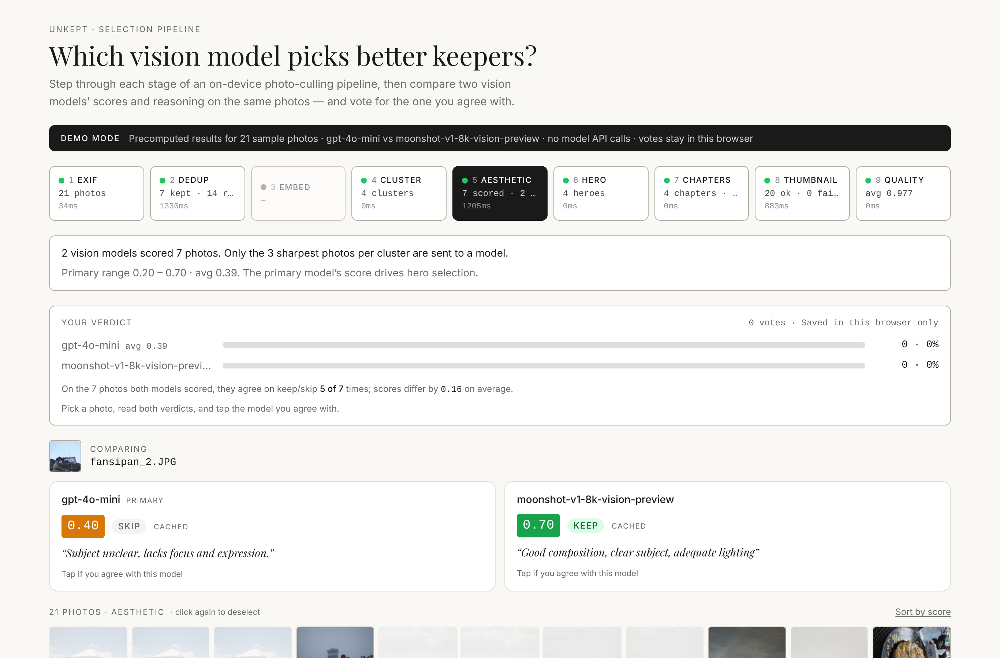
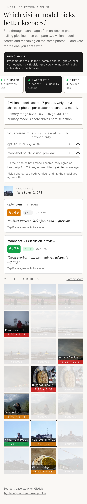

[](https://app.netlify.com/projects/unkept/deploys)

# Unkept: which vision model picks better keepers?

**[Open the demo →](https://unkept.netlify.app/pipeline)**: no sign-up, no API keys, no cost. **[Use the app →](https://unkept.netlify.app)** with your own photos (they never leave the browser).

Unkept culls a messy camera roll into a short set of keepers. Most of that work runs on-device with classical computer vision: EXIF, perceptual dedup, clustering and sharpness. The one step that needs taste is deciding which near-identical shot is the keeper, so that step goes to a vision LLM. **The open question was which model: a cheap one or a good one?**

<!-- Screenshots: export the fixture (docs/ai-aesthetic-proxy.md → "Demo mode and the fixture"),
     then cd client && npm run build:demo && npm run demo:screenshots -->
 

## What the demo shows

`/pipeline` walks through every stage on 21 sample photos: EXIF → dedup → CLIP embedding (off in the demo build) → clustering → aesthetic scoring → hero → chapters → thumbnail → quality. On the aesthetic stage, **two models score the same photo side by side**, each with a score, a keep/skip call and a one-line reason. You vote for the one you agree with, and a tally adds up your verdict next to the models' own agreement rate and average score gap.

**On the sample set, GPT-4o-mini vs Kimi** (`moonshot-v1-8k-vision-preview`), same prompt: they agree on keep/skip for **5 of 7** photos, and scores differ by **0.16** on average. Kimi is consistently more lenient: it averages **0.54** to GPT-4o-mini's **0.39** and keeps 4 photos to GPT-4o-mini's 2. Both disagreements are Kimi keeping a photo GPT-4o-mini skips. On `fansipan_2.JPG`, GPT-4o-mini scores 0.40 and skips it ("Subject unclear, lacks focus and expression."), while Kimi scores 0.70 and keeps it ("Good composition, clear subject, adequate lighting"). Seven photos is an anecdote, not a benchmark, which is why the demo asks for your vote.

## Key decisions

- **Two models at a time, not a leaderboard.** A head-to-head on the same photo makes the difference concrete ("subject unclear" vs "clear subject" on the same shot), and a human vote settles it. The primary model drives hero selection; the second exists only for comparison. Swapping either one is a change of environment variables, because both go through one OpenAI-compatible proxy.
- **A cheap filter in front of the expensive model.** A Laplacian sharpness check picks the top 3 photos per cluster; only those reach the LLM. This keeps cost bounded however large the photo roll is.
- **Caching after hitting Kimi's concurrency limit.** Scores are cached by `sha256(model + prompt + image)`, so a re-run never re-bills a photo, and changing the prompt or model invalidates the cache automatically. Only successful scores are cached.
- **Batching and a concurrency cap after PR review.** The client sends batches of 4, and the proxy allows at most `LLM_CONCURRENCY` calls in flight per provider. A 429 now shows up as a specific, actionable message on the affected card instead of a silent `null`.
- **A demo that costs nothing.** `DEMO_MODE` replays a static fixture built from the score cache. In that mode the scoring and embedding stages return before any network call, and the fixture generator answers model requests only from the cache. Votes stay in `localStorage`.

## Where AI helped vs where human judgement was needed

- **AI helped:** scaffolding the proxy, the cache, the tests, and this debug UI. It also did the scoring itself, turning "is this a good photo?" into a number plus a reason a person can disagree with.
- **Human judgement was needed:**
  - Deciding which model is *right*. That's what the vote is for.
  - Noticing when a heuristic is wrong by looking at it. aHash and dHash both failed on real bursts, and only the per-stage view showed why.
  - Choosing what is worth paying a model for in the first place.

## Next steps

- **A model proxy layer:** routing, fallback and per-request cost tracking, so "cheap vs good" becomes a live policy rather than a config choice.
- **Prompt A/B tests:** the same model with two prompts, using the same voting UI and the cache key that already includes the prompt.

---

<details>
<summary><b>Run it locally</b></summary>

```bash
# Demo: precomputed results, no keys, no server
cd client && npm install && npm run demo      # → http://localhost:5173/pipeline

# Live pipeline against real models (needs keys; see docs/ai-aesthetic-proxy.md)
cp server/.env.example server/.env            # fill LLM_* (and LLM_*_2 for a comparison)
cd server && npm install && npm run dev
cd client && npm run dev:debug                # → http://localhost:5173/pipeline

# Tests
cd client && npm test && cd ../server && npm test
```

Deploys on Netlify from `netlify.toml` (static build, `DEMO_MODE=true`). Architecture: [`ARCHITECTURE.md`](ARCHITECTURE.md) · proxy, caching and fixture: [`docs/ai-aesthetic-proxy.md`](docs/ai-aesthetic-proxy.md).
</details>
